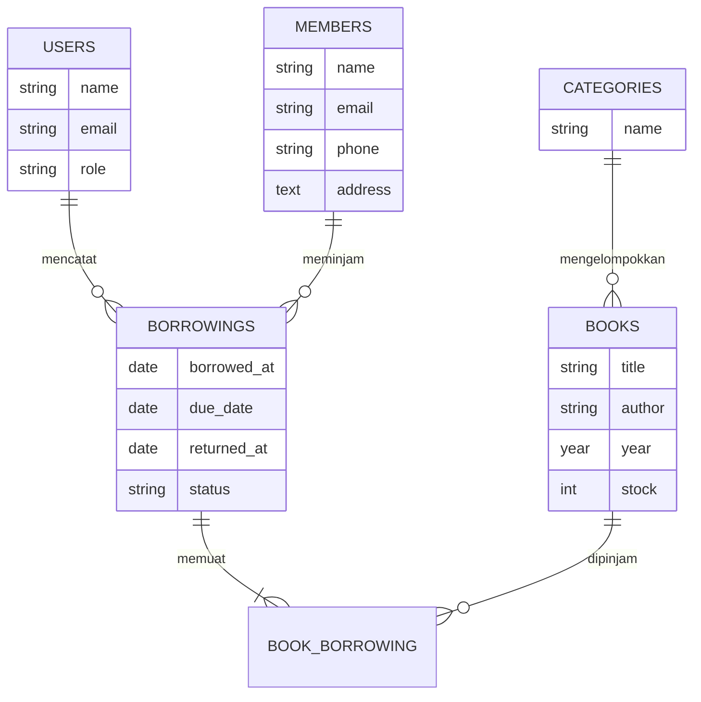

# Sistem Informasi Perpustakaan Sederhana

Aplikasi web untuk mengelola perpustakaan kecil: katalog buku, anggota, serta peminjaman dan pengembalian.
Dibuat dengan **Laravel**, **Blade**, **Tailwind CSS**, dan **MySQL** sebagai proyek akhir mata kuliah Framework.

## Fitur

| Modul | Isi |
|---|---|
| Autentikasi | Login, logout, halaman terlindungi, pembatasan percobaan login (5 kali per menit) |
| Pengguna | Lihat, tambah, ubah, hapus user dan tentukan role (khusus admin) |
| Kategori | Daftar, tambah, ubah, hapus (admin); petugas hanya melihat |
| Buku | Daftar dengan pencarian judul/penulis, filter kategori, pagination; detail, tambah, ubah, hapus; pilih kategori |
| Anggota | Daftar dengan pencarian, detail beserta riwayat peminjaman, tambah, ubah, hapus |
| Peminjaman | Catat peminjaman (petugas pencatat, anggota, tanggal pinjam, jatuh tempo 7 hari, beberapa buku, stok berkurang), daftar dengan filter status, detail |
| Pengembalian | Catat tanggal kembali, status menjadi `returned`, stok bertambah |
| Dashboard | Jumlah judul buku, total stok, jumlah anggota, jumlah yang sedang dipinjam, plus daftar peminjaman terlambat dan terbaru |

### Hak akses

| | Admin | Petugas |
|---|---|---|
| Login / logout | Ya | Ya |
| Kelola pengguna | Ya | Tidak |
| Kategori | Tambah, ubah, hapus, lihat | Hanya lihat |
| Buku | Penuh | Penuh |
| Anggota | Penuh | Penuh |
| Peminjaman dan pengembalian | Penuh | Penuh |

Pembatasan dilakukan di server (middleware `role` pada rute dan pengecekan di Form Request), bukan hanya dengan menyembunyikan tombol.

## Teknologi

* PHP ^8.3 dan Laravel ^13
* MySQL (migration, Eloquent ORM, relasi, transaksi database)
* Blade dengan komponen anonim, Tailwind CSS v4 lewat Vite
* JavaScript minimal (menu mobile, filter daftar buku pada form peminjaman, tombol submit yang dinonaktifkan saat diproses)
* PHPUnit untuk pengujian

## Instalasi

Prasyarat: PHP ^8.3, Composer, Node.js dan npm, serta MySQL.

1. Clone repository dan masuk ke foldernya.
2. Pasang dependency dan bangun aset:

   ```
   composer install
   npm install
   npm run build
   ```

3. Siapkan environment:

   ```
   cp .env.example .env
   php artisan key:generate
   ```

4. Buat database MySQL bernama `library-system-uas`, lalu sesuaikan `DB_USERNAME` dan `DB_PASSWORD` di `.env`.
5. Buat tabel dan isi data contoh:

   ```
   php artisan migrate --seed
   ```

6. Jalankan aplikasi:

   ```
   php artisan serve
   ```

   Buka `http://localhost:8000`. Saat mengembangkan tampilan, jalankan `npm run dev` di terminal lain.

### Akun contoh (hanya untuk pengembangan lokal)

| Email | Password | Role |
|---|---|---|
| admin@example.com | password | admin |
| petugas@example.com | password | petugas |

Ganti atau hapus akun ini sebelum aplikasi dipakai di luar lokal.

### Data contoh

`php artisan migrate --seed` mengisi 8 kategori, 13 buku, 5 anggota, dan 5 transaksi peminjaman
(1 aktif, 2 terlambat, 2 sudah dikembalikan) sehingga dashboard langsung berisi. Tanggal transaksi dihitung dari hari ini.
Seeder aman dijalankan ulang dan tidak menimpa data yang sudah ada.

## Aturan bisnis

* **Jatuh tempo** = tanggal pinjam + 7 hari, dihitung otomatis oleh server.
* **Peminjaman** hanya untuk buku yang stoknya masih ada, satu eksemplar per buku, dan satu buku tidak boleh dipilih dua kali dalam satu transaksi.
* **Stok** berkurang saat peminjaman dicatat dan bertambah saat dikembalikan. Kedua proses berjalan dalam satu transaksi database dengan penguncian baris (`lockForUpdate`), sehingga stok tidak bisa minus dan pengembalian tidak bisa dihitung dua kali.
* **Terlambat** berarti belum dikembalikan dan sudah lewat jatuh tempo.
* **Penghapusan dibatasi:** kategori yang masih dipakai buku, serta buku, anggota, dan user yang punya riwayat peminjaman, tidak bisa dihapus. Aturan ini dijaga oleh foreign key (`restrictOnDelete`) dan pesan yang jelas di aplikasi.

## Skema database



## Struktur proyek

```
app/Http/Controllers   Controller per modul (MVC)
app/Http/Requests      Validasi (Form Request) dan otorisasi
app/Http/Middleware    EnsureUserHasRole (alias "role")
app/Models             Model Eloquent dan relasinya
database/migrations    Skema tabel
database/seeders       Data contoh
database/factories     Factory untuk pengujian
resources/views        Layout, komponen Blade, dan halaman per modul
lang/id                Pesan validasi Bahasa Indonesia
tests                  Pengujian fitur dan unit
```

## Pengujian

```
php artisan test
./vendor/bin/pint --test
```

Pengujian memakai SQLite di memori (lihat `phpunit.xml`), jadi tidak menyentuh database MySQL Anda.
Pengujian mencakup autentikasi, pembatasan role, CRUD tiap modul, validasi, aturan peminjaman dan stok, dashboard, dan halaman error.

## Alur Git

Pengembangan dikerjakan per tahap pada branch tersendiri (`feat/...`) dan digabungkan lewat pull request ke `master`.
Branch `main` berisi hasil akhir yang sudah stabil.

## Deployment

* Set `APP_ENV=production` dan `APP_DEBUG=false` di `.env` agar detail error tidak tampil ke pengguna.
* Jalankan `npm run build` dan `php artisan migrate --force`.
* Ganti password akun contoh atau hapus akunnya.

## Author

Waylend Yutani
